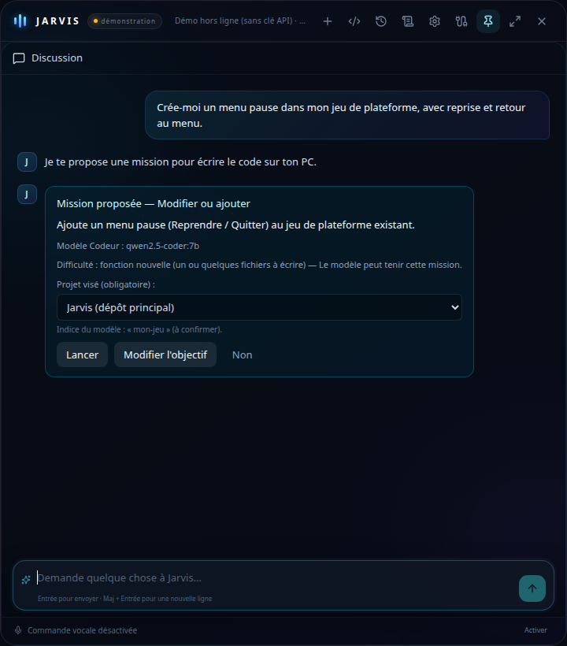
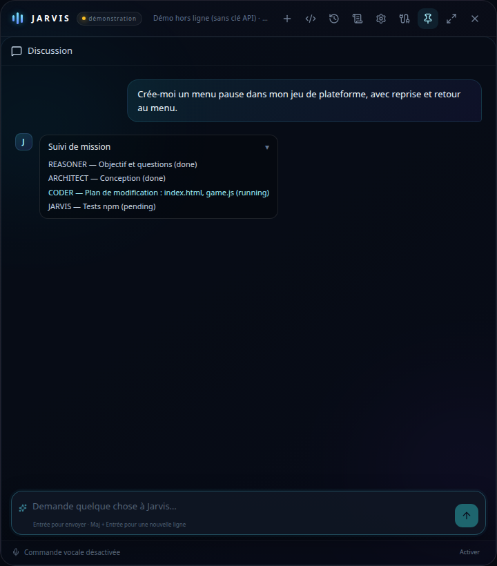
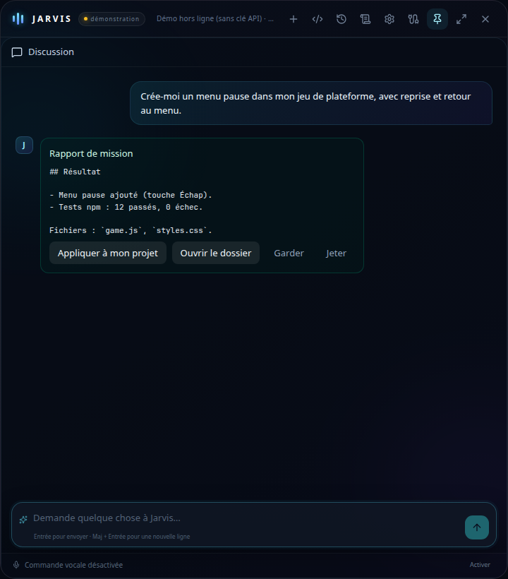

# Rapport — Discussion unifiée et missions (5.0.68)

Branche : `cursor/chat-unifie-5068`. Cahier : `docs/specs/chat-unifie.md`.

## Livré (phase 1)

- Réglage `developer.chatMissions` (point 1, commit précédent).
- Équipe **Code** : outil `proposer_mission`, consigne `CODE_MISSION_TOOL_PROMPT`, `ChatMissionHub.recordProposal`, tests `chat-missions-proposer.test.ts`.
- Carte **Mission proposée** dans la discussion (`ChatMissionProposalCard`, événement `mission_proposal`, persistance `ChatMessage.chatMission`).
- Choix du **projet** (Jarvis, registre, nouveau projet) — jamais deviné.
- **Suivi** (`ChatMissionTrackCard`, sync depuis `DeveloperState.mission`), confirmations développeur dans `UnifiedJarvisChat`, réponses REASONER via `answerMission`.
- **Rapport** (`ChatMissionReportCard`) : Appliquer, Ouvrir dossier (processus principal), Garder, Jeter.
- Une mission active **bloque** une nouvelle proposition (`blockedMessage`).
- **Téléphone** et **enceinte** : affichage / phrase dédiée, jamais lancement depuis l'enceinte.
- **Historique** : `missionId` sur les messages, `reloadConversationMissions` + `openMission`.
- **Voix** : une phrase à la création de la proposition (`voiceHint`).

## Scènes d'aperçu (captures)

Aperçu Vite (`apps/desktop/vite.ui.config.ts`, port **43173**) :

| Scène | URL | Capture |
| --- | --- | --- |
| Carte mission proposée | `http://127.0.0.1:43173/?scene=chat-mission-proposal` |  |
| Suivi mission | `http://127.0.0.1:43173/?scene=chat-mission-track` |  |
| Rapport | `http://127.0.0.1:43173/?scene=chat-mission-report` |  |

Regénérer les PNG (Chrome headless) :

```bash
cd apps/desktop && npx vite --config vite.ui.config.ts
# autre terminal, avec puppeteer-core installé localement :
node scripts/capture-chat-unifie.mjs
```

Fichiers dans ce dossier :

- `rapports/chat-unifie-proposal.png`
- `rapports/chat-unifie-track.png`
- `rapports/chat-unifie-report.png`

## RAPPORT DE VÉRIFICATION

**Testé en vrai : PAS FAIT** (environnement Linux cloud : pas de fenêtre Electron ni Ollama complet sur le PC utilisateur).

**Automatisé (agent cloud)** :

- `npm run typecheck` : OK
- `npm test` : OK (653 tests passés, 6 ignorés ; +2 `chat-missions-proposer.test.ts`)
- `npm run lint` : OK
- Captures d'aperçu : générées via `scripts/capture-chat-unifie.mjs` et scènes `?scene=chat-mission-*`

## Commits

Voir historique Git `5.0.68 — point N : …` sur `cursor/chat-unifie-5068`.
