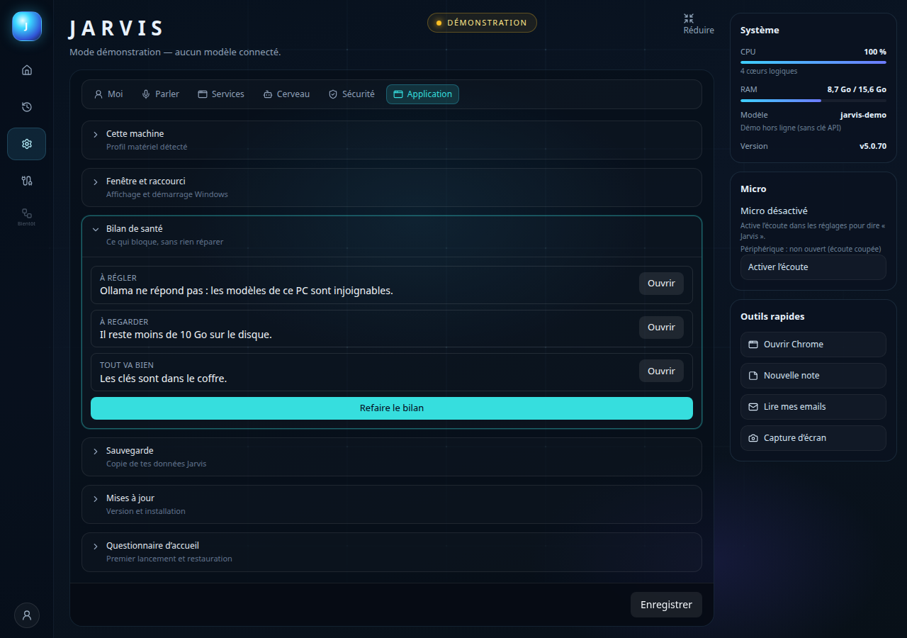
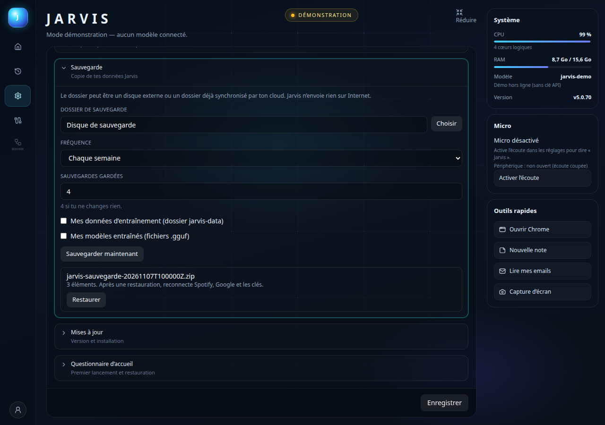
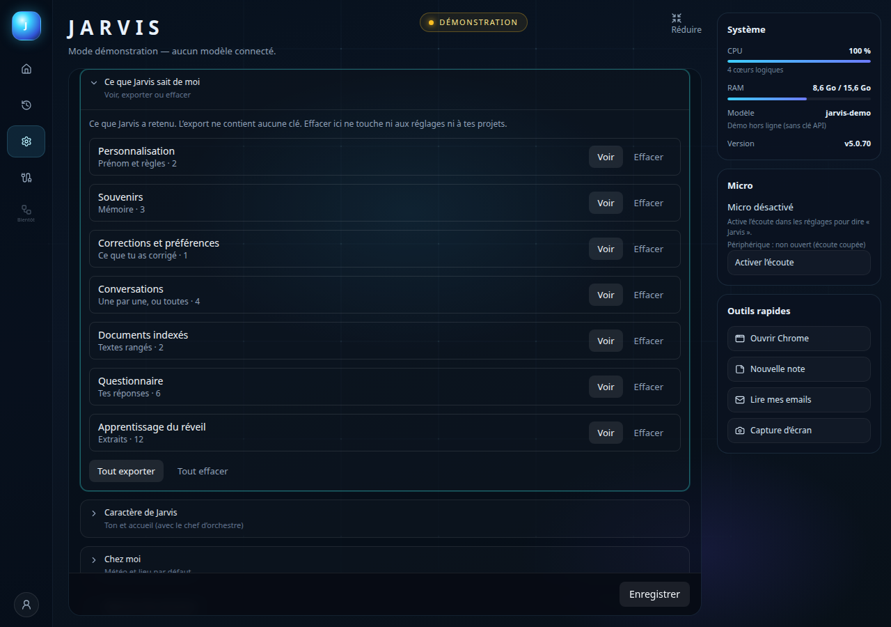
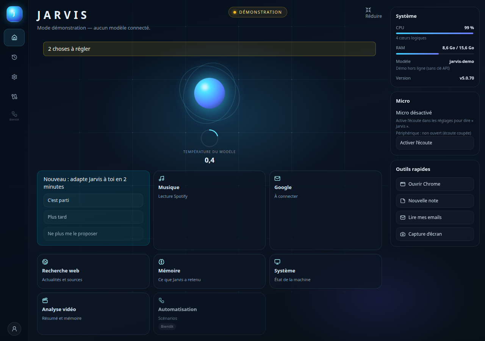

# Lot A — Fiabilité (8 novembre 2026)

Cahier lu sur `origin/claude/specs-feuille-de-route` : `docs/specs/regles-communes-lots.md` et `docs/specs/lot-a-fiabilite.md`. La copie de secours `/tmp/feuille-de-route/` n’a pas servi. Branche `cursor/lot-a-fiabilite`, depuis `origin/main`. Pas de fusion dans `main`, pas de publication.

## Fait

- **A1. Bilan de santé.** Après l’affichage de la fenêtre, contrôles bornés à 3 s (10 s en tout), sans modèle. Un service non réglé n’est pas contrôlé. Vert, orange ou rouge, une phrase simple, un bouton vers le bon réglage. Accueil : bandeau « N choses à régler » seulement s’il y a un souci. Réglages → Application → « Bilan de santé » et « Refaire le bilan ». Dans la discussion : « Jarvis, est-ce que tout va bien ? », « fais ton bilan » (règle express). À la voix, une phrase courte. Le bilan ne répare rien, ne télécharge rien, ne relance rien. L’imprimante (lot B) n’est pas contrôlée tant qu’elle n’est pas réglée.
- **A2. Sauvegarde.** Réglages → Application → « Sauvegarde ». Dossier choisi, chaque jour ou chaque semaine, nombre gardé (4 dans le code si absent). Cases entraînement et modèles décochées, dossiers choisis par toi (aucun chemin inventé). Zip `jarvis-sauvegarde-*.zip`, écrit en `.partiel`, relu (empreintes), sinon marqué ratée. `settings.json` sans secret. Pas de jetons Spotify, Google, ni coffre. Rotation uniquement sur `jarvis-sauvegarde-*.zip`. Restauration : liste, carte de confirmation, copie de sécurité, redémarrage. Automatique seulement PC inactif, au plus une fois par période. Réglage `backup` facultatif : `parseSettings({})` ne le gagne pas.
- **A3. Ce que Jarvis sait de moi.** Réglages → Moi. Une ligne par catégorie, nombre, Voir, Exporter, Effacer (bouton en deux temps). Conversations une par une ou toutes. Trieur seulement si son dossier est réglé. « Tout exporter » : zip texte, sans secret. « Tout effacer » : carte, puis ces catégories seulement (pas les réglages, pas les projets).
- **A4. Coffre des clés.** Liste unique des champs que `redactValue` masque déjà, testée contre le schéma. Chiffrement `safeStorage` dans `userData/coffre.bin`. `settings.json` garde la chaîne vide. Migration au démarrage (écriture tmp + rename). La fenêtre reçoit « clé enregistrée ». Champ inchangé : la clé reste. Champ vidé : elle part. Champ rempli : elle est remplacée. Sans chiffrement : comportement d’avant, et le bilan le dit.

## Testé

Sur cette machine (Linux, sans Windows, sans voix, sans Ollama, sans GPU) :

- `npm run typecheck` : vert.
- `npm test` : cœur 191 fichiers, 2256 tests ; bureau 135 fichiers passés, 4 ignorés, 685 tests passés, 6 ignorés. Aucun échec. Les tests qui simulent un SDK .NET absent sont verts. Aucun `ENOENT` réel de `dotnet` dans cette exécution : le SDK n’a pas été appelé.
- `npm run lint` : vert.
- `parseSettings({})` ne gagne pas `backup`. Les `__golden__` n’ont pas été régénérés.
- Aperçus Vite (scènes `health`, `backup`, `know`, accueil) : captures ci-dessous. Aucune donnée personnelle, aucun chemin de personne.

## Non testé sur Windows

- Chiffrement DPAPI (`safeStorage`) et migration d’un vrai `settings.json` qui contient encore des clés.
- Bilan réel : Ollama, modèles installés, fichiers de voix, Piper, Spotify, Google, Tailscale, enceintes, robot, place disque.
- Choix de dossier (fenêtre Windows), zip sur un disque externe, restauration puis redémarrage de l’application.
- Voix : la phrase courte du bilan n’a pas été dite.

## Questions pour l’utilisateur

1. Où sont le dossier `jarvis-data` et le dossier des fichiers `.gguf` ? Jarvis ne devine pas ces chemins : il faut les choisir dans Sauvegarde si tu veux les copier.
2. Après une restauration sur un autre PC, Spotify, Google et les clés sont à reconnecter. Le coffre de l’ancien PC n’est pas dans la sauvegarde. C’est bien ce que tu veux ?
3. Si tu choisis un dossier sans toucher à la fréquence, Jarvis sauvegarde chaque jour. Quatre archives sont gardées si tu ne changes pas le nombre. Ça te va ?

## Phrases à essayer

- Jarvis, est-ce que tout va bien ?
- fais ton bilan
- fais le bilan de santé

Testé en vrai (à la voix, sur le PC) : PAS FAIT

## RAPPORT DE VÉRIFICATION

- Build : pas relancé en entier (`npm run build` du bureau télécharge les voix). `npm run typecheck` reconstruit le cœur et vérifie les types du bureau : vert.
- Types : vert (`npm run typecheck`).
- Style : vert (`npm run lint`).
- Tests : vert (`npm test`), voir les chiffres plus haut. Les `__golden__` n’ont pas été régénérés. `chat-unchanged`, `ollama-unchanged`, orchestre, profil machine et profil Jarvis font partie de la suite verte.
- Secrets : les tests du coffre et de la sauvegarde vérifient qu’une clé d’exemple ne reste ni dans `settings.json` exporté, ni dans le zip, ni dans l’objet montré à la fenêtre. Aucun secret réel dans le dépôt.
- Relecture : le bilan est en lecture seule ; restaurer et « tout effacer » passent par une carte ; effacer une catégorie passe par le bouton en deux temps ; un arrêt de chat n’est pas passé par ces cartes.

Testé en vrai (à la voix, sur le PC) : PAS FAIT
